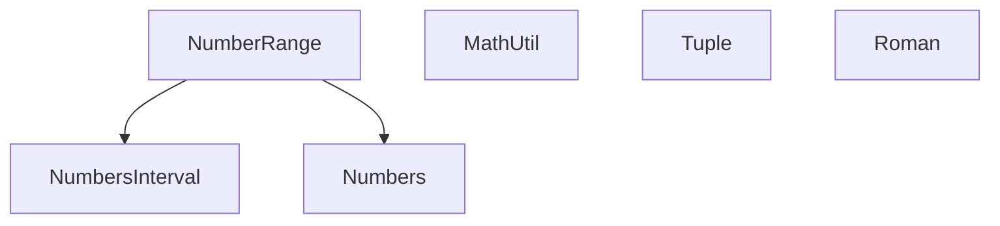
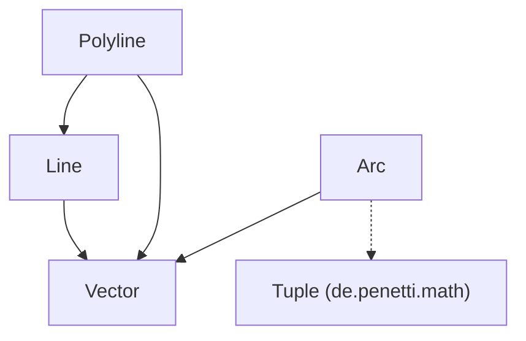
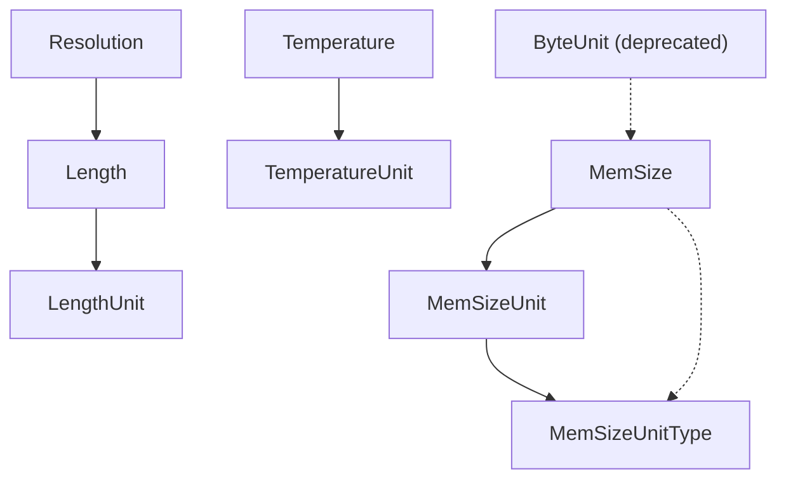

# Klassenübersicht `math-tools`

Das Projekt hat 20 Klassen in vier Paketen unter `de.penetti`. Die einzige Abhängigkeit nach außen ist Jama (Matrizen).

### `de.penetti.math`

### `de.penetti.math.geom`

### `de.penetti.physics`

### `de.penetti.util`

Die Pfeile sind zum Teil aus `import`-Anweisungen und Methodensignaturen abgeleitet und nicht alle im Code geprüft. Bei `NumberRange → Numbers` und `Line → Vector` bin ich nicht ganz sicher.

## `de.penetti.math`: Zahlen und Grundlagen

| Klasse | Aufgabe |
|---|---|
| `MathUtil` | Hilfsfunktionen: `round` (mit Nachkommastellen) und `adjustAngle` (Winkel im Bogenmaß normalisieren). |
| `Numbers` | Generische Hilfen für `Number & Comparable`: `min`, `max`, `compare`, `isNaN`, `isInfinity` und das Enum `Infinity`. |
| `NumbersInterval` | Enum für Intervallarten (offen oder geschlossen). Es prüft über `contains(left, value, right)`, ob ein Wert im Intervall liegt, und `check` validiert die Grenzen. |
| `NumberRange<T>` | Wertebereich aus Minimum, Maximum und Intervallart. Hat `contains` und `adjust` (Wert in den Bereich zwingen). |
| `Tuple<T>` | Unveränderliche Zahlenfolge mit Parsing aus Strings (`fromDoubleString`, `fromIntegerString`, `fromGenericString`) und `toGenericString`. |
| `Roman` | Römische Zahlen: Konvertierung in beide Richtungen, mehrere Schreibweisen über das Enum `Strategy` (z. B. `MMMIM`, `MMMCMXCIX`). Hat eine `main`-Methode. |

## `de.penetti.math.geom`: 2D-Geometrie

| Klasse | Aufgabe |
|---|---|
| `Vector` | 2D-Punkt oder -Vektor: `add`, `sub`, `mul`, `rotate`, `angle`, `length` und Zufallsvektoren. Unveränderlich. |
| `Line` | Strecke mit Builder (`withOrigin(...)`): Länge, Steigung, Winkel, Normale, `contains`, `classify` (`PointStatus`, `LineStatus`) und Schnittpunkte. |
| `Polyline` | Linienzug mit Builder (`startAt(...)`): Länge, Fläche, Orientierung (`ccw`/`cw`), Schwerpunkt, Schnittpunkte mit `Line` oder `Polyline` (`LineIntersection`, `PolylineIntersection`). |
| `Arc` | Kreis- oder Ellipsenbogen. Wird aus Mittelpunkt und Radien oder aus Start, Ende und Bulge gebaut. |

## `de.penetti.physics`: Einheiten

Alle Einheiten folgen demselben Muster: ein Enum als Einheit und eine Klasse als Wert mit Einheit.

| Klasse | Aufgabe |
|---|---|
| `LengthUnit` | Enum der Längeneinheiten mit Faktor, Zeichen und `Type`. Rechnet um (`getValue`) und sucht über `getByType` oder `getByTypeAndSign`. Die Namen kommen aus `lengthunit*.properties`. |
| `Length` | Länge als Wert mit Einheit, umrechenbar, Vergleich mit Toleranz. |
| `Resolution` | Auflösung aus Punkten und Länge, zum Beispiel dpi, mit `getDotsPerMeter`. |
| `TemperatureUnit` | Enum für Temperatureinheiten mit Umrechnung. Die Namen kommen aus `temperatureunit*.properties`. |
| `Temperature` | Temperatur als Wert mit Einheit, `getBaseTemperature`, Vergleich mit Toleranz. |
| `MemSizeUnit` | Enum der Speichereinheiten: `Byte`, binär (`KiB` bis `YiB`, Basis 1024) und dezimal (`KB` bis `YB`, Basis 1000). Hat Symbol, Typ und Faktor als `BigInteger`. `of(String)` findet eine Einheit ohne Beachtung der Groß-/Kleinschreibung. |
| `MemSizeUnitType` | Enum `Byte`, `Decimal` (1000) und `Binary` (1024). Gruppiert die Einheiten von `MemSizeUnit`. |
| `MemSize` | Unveränderliche Speichergröße in Bytes (`BigInteger`, daher ohne Obergrenze durch `long`). Hat nur private Konstruktoren und wird über die Factories `ofBytes`, `of(Wert, Einheit)` oder `parse("1.5 GiB")` gebaut (locale-unabhängig: Punkt als Dezimaltrennzeichen). `parseLocalized("1,5 GiB")` liest dagegen die Schreibweise der Default-Locale. Hat `add`, `subtract`, `compareTo`, `toUnit` und `humanReadable`. Bruchteile von Bytes werden abgeschnitten. Ausgabe (`humanReadable` mit gewählter Einheit, `format(MemSizeUnit, int)` mit fester Einheit) und `parseLocalized` richten sich nach der aktuellen Default-Locale. Die höchste Zahl der Nachkommastellen ist wählbar (`humanReadable(int)`, `format(MemSizeUnit, int)`, Standard bei `humanReadable()` 3). |
| `ByteUnit` | **Veraltet, stattdessen `MemSize`.** Enum `Binary` (KiB, 1024) und `Decimal` (KB, 1000). `format(long)` liefert eine locale-abhängige Ausgabe wie `1,5 KiB`. |

## `de.penetti.util`

| Klasse | Aufgabe |
|---|---|
| `Base64` | Kodieren und Dekodieren von Strings, Byte-Arrays und Dateien. Hat eine `main`-Methode. |

## Zusammenfassung der Struktur

- **Vorlage für Wert und Einheit:** `Length`/`LengthUnit` und `Temperature`/`TemperatureUnit`. `Resolution` baut auf `Length` auf. `MemSize`/`MemSizeUnit` folgen demselben Muster. Der Vorgänger `ByteUnit` war nur eine Formatierungshilfe ohne Wertklasse und ist veraltet.
- **Immutable Value Objects:** `Vector`, `Tuple`, `Length`, `Temperature`, `MemSize` und `Roman` sind unveränderlich. `Line` und `Polyline` werden über Builder mit Typ-Stufen (`MoveTo`, `Direction`, `Build`) aufgebaut, sodass der Compiler die Aufrufreihenfolge erzwingt.
- **Ressourcen:** Die Einheitennamen liegen in `.properties`-Dateien mit deutscher (`_de`) und Standardvariante. `MemSizeUnit` nutzt keine Ressourcen, die Symbole stehen fest im Enum.
